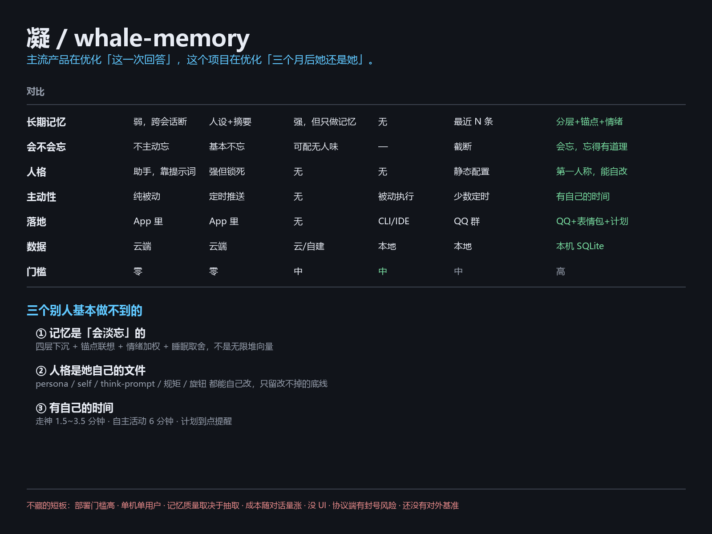

# 凝 / whale-memory

一个住在 QQ 里的长期陪伴型 AI。不是通用助手，是「有个性、有记忆、会自己找事做」的那种存在。



「无限上下文」怎么做的：[图](docs/infinite-context.png) · 对比细节：[docs/COMPARISON.md](docs/COMPARISON.md) · 30 秒演示：[docs/DEMO.md](docs/DEMO.md)（`node demo/recall-demo.ts`）

## 它有什么

- **分层记忆**：detailed → compressed → fossil → cold，按预算下沉，不是按时间遗忘
- **锚点网络**：只有三类——人、事、环境。宁可少连，不做垃圾桶
- **事件卡**：一条 = 一件事（约定/待办/决策/经历/信息/冲突），带状态、价值分、原话证据
- **人物图**：people ↔ 锚点真正绑定（号码锚点/名字锚点/别名是同一个人），
  `event_anchors.role` 区分「谁说的 / 关于他的」，提示词里按人挂内容
- **群名册**：从 OneBot 拉全群成员（不只是说过话的人），进群退群自动跟上
- **词库 / 知识库 / 人物库**：梗归词库、理论归知识库、偏好归人物库，各归其位
- **会走神**：随机锚点 → 关联记忆 → 拍个决定（去做 / 去找人 / 算了）
- **本机眼睛**：qwen2.5vl 本地看图，不花钱、不上传（Ollama 没起来会说「看图没成功」，不会怪图糊）
- **计划表**：想做的事写进 plans（干什么 / 为什么 / 定于何时 / 每多久提醒），到点会插进走神里提醒她；
  提醒≠必须做，可以改时间、可以做完（做完会写成一条记忆并挂到锚点上）
- **能改自己**：人格（persona.md）、自我描述（self.md）、走神提示词（think-prompt.md）、
  说话规矩（speech-rules.md）、抽取规矩（extract-rules.md）都是她的文件，有对应工具读写
- **表情包**：搜狗搜图 + 本地图库（含「大肥鱼」24 张）+ 自动收群里别人发的好图；
  每小时最多 6 张、同一张 30 分钟冷却
- **看图**：当前这条消息可带原图给多模态模型（历史里只留文字描述，不然上下文会爆）
- **能动手**：手机（ADB）、B 站（搜索/看字幕/点赞）、读自己的运行日志
- **工具轮次不设上限**：跑到它自己不再调工具为止（`maxToolRounds = 0`），
  刹车交给每日预算和单次超时

和主流方案的对比（含优缺点、适合谁）见 [docs/COMPARISON.md](docs/COMPARISON.md)。

## 人格模板

`personas/free/` 是一套开箱可用的人格（persona.md + self.md），拷进 `data/` 就生效：

```bash
cp personas/free/persona.md data/persona.md
cp personas/free/self.md    data/self.md
```

写法、常见坑、怎么迭代，见 [personas/README.md](personas/README.md)。
这几份模板里**没有任何聊天记录或账号信息**——它们只是提示词。

## 验证

仓库里有 20+ 个自检脚本（`node tools/verify-*.ts`），覆盖记忆检索、人物绑定、群名册、
看图、计划表、表情包、工具接口、日志切段等，共 259 项断言。
它们跑的是真实入口（`service.handle` / `think` / 工具调用），不是只 import 一下。

## 技术上

零依赖 Node 24：

- 原生 `node:sqlite`，不用 better-sqlite3
- 原生 TypeScript 类型剥离，不用构建
- 原生 WebSocket，客户端只要 40 行
- `npm install` 都不用，`node src/bot.ts` 直接跑

## 怎么跑起来

1. **装 NapCat**（把 QQ 变成 OneBot 11 服务）
2. **准备一个 QQ 号**（建议小号）和一个群
3. **建库**（会建表，并灌 17 个演示锚点）

   ```bash
   node src/cli.ts init
   ```

   > 没有 `data/seed-anchors.json` 也能跑：会提示「先用空锚点」，锚点本来就会从对话里长出来。

4. **复制配置**

   ```bash
   cp data/bot.example.json data/bot.json
   ```

5. **填三样东西**

   | 字段 | 填什么 |
   |---|---|
   | `deepseekApiKey` | 你的 DeepSeek key |
   | `selfId` | 机器人自己的 QQ 号 |
   | `allowPrivate` / `allowGroups` | 允许它私聊 / 说话的号 |

6. **启动**

   ```bash
   node src/bot.ts
   ```

   Windows 也可以双击 `run-bot.cmd`。

## 第一次启动会发生什么

- 自动建库 `data/memory.db`
- 自我描述是空的，它会用 `self_write` 自己写一份
- 没有记忆、没有锚点、没有词——**全都是聊出来的**

## 文档

- [`docs/architecture.md`](docs/architecture.md) 记忆架构（为什么这么设计）
- [`docs/blueprint.md`](docs/blueprint.md) 现状施工图：记忆结构 / 行为结构 / 整体结构 + 复刻路线（**想照着做一套，先看这份**）
- [`docs/extraction.md`](docs/extraction.md) 抽取全链路（含四个坑）
- [`docs/plan-memory-refactor.md`](docs/plan-memory-refactor.md) 三类分仓的规划
- [`docs/future-scoring.md`](docs/future-scoring.md) 为什么规则打分不如模型打分
- [`AGENTS.md`](AGENTS.md) 改这个项目的工程约定（血泪版）

## 别期待什么

- 不是开箱即用的产品，是**一个还在长的东西**
- 记忆质量取决于模型和提示词，需要自己调
- 群聊会吵，建议先设成"只被 @ 才说话"

## License

MIT
