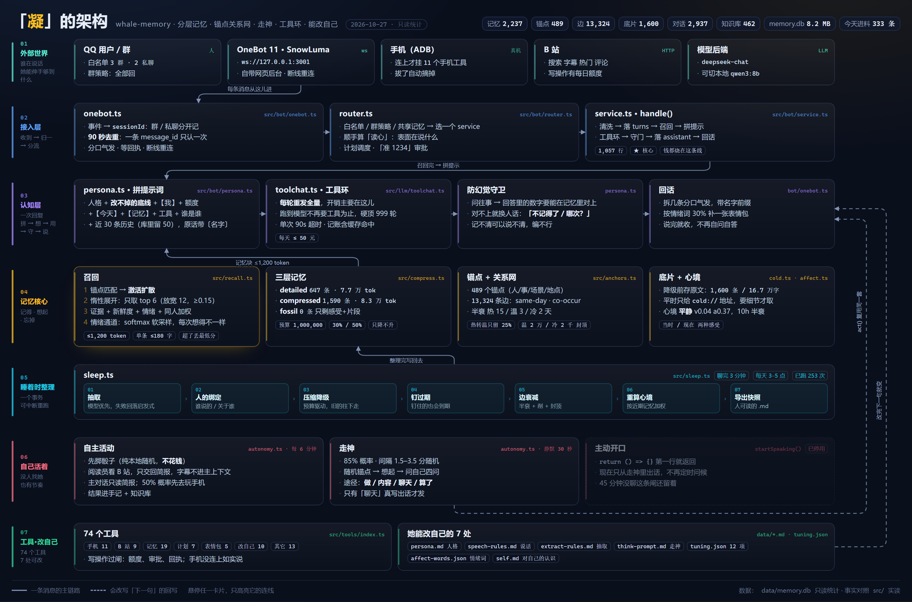

# 凝 · 一个会忘事的记忆结构

> 给 AI 一份**会淡忘**的长期记忆——不是把聊天记录存下来，而是记成「事」、连成「关系」、按预算往下沉。
>
> 解决的问题很简单：**上下文一满，AI 就像换了个人。**



<sub>点开看大图。想追某条数据流，用可交互版 `docs/architecture-map.html`——鼠标停在任意卡片上，只有它的连线会亮。</sub>

---

## 它到底解决什么

大多数人给 AI 加记忆，走的是两条路，都不太对：

| 做法 | 问题 |
|---|---|
| 把聊天记录全塞进提示词 | 几百条之后上下文爆了，而且模型读长文本的能力会掉 |
| 存成向量库，检索 top-k 塞回去 | 找出来的都是「字面像」的碎片，没有前因后果；永远不知道哪件事更重要 |

这套东西走的是第三条：**像人一样记。**

- 一件事记得越久，细节越少——但不是说没就没，是**越来越难想起来**
- 重要的事一直清楚，不重要的事慢慢只剩一句感受
- 想起来的时候，是「被什么勾起来」的，不是被关键词搜出来的
- 情绪会随时间淡掉，事还在

## 三个核心机制

**① 按预算遗忘，不按时间**

不是「30 天前的删掉」，是「总量超了就往下沉」：

```
detailed    完整原文
compressed  只剩起因 + 结果 + 一句核心
fossil      只剩一个片段和一句感受
冷存储       只剩一个地址 cold://事件ID，需要时能挖回来
```

沉的时候从**「最不重要 + 最旧」**开始，所以重要的事一直浮在上面。而且这道坎是**单向**的——沉下去不会升回来。

**② 关键事实穿透所有层**

金额、日期、结论这类东西（`良性`、`两千块`、`四月二十八号`）单独存一份 `key_facts`，**任何一层都不许压掉**。所以两年后问「我妈那次手术结果」，它还能答出「良性」。

**③ 锚点 + 扩散激活**

记的不是孤立的事，是「事 ↔ 人/地/物/主题」的多对多关系。想起来的时候：

```
问题 → 落到锚点 → 沿关系网扩散（一层算一半，两层算四分之一）
     → 拿到一批候选事 → 按证据、情绪、新鲜度排序
```

所以「我妈那次手术」和「甲状腺」能连起来，哪怕从没写在同一句话里。

## 还有几件小但重要的

- **重复会加强**：同一件事提 N 次，权重 ×(1+0.25·(N−1))，遗忘时最后才沉
- **情绪会淡**：心情有半衰期（10 小时），三天前很气的事，今天只剩「当时挺气的」
- **写的时候就带上下文**：存新事时先看前后 7 天，能猜出「他说的那个她是谁」
- **忘掉的能挖回来**：冷存储留了地址，明确问「挖一下 cold://xxx」能捞出摘要

## 目录

```
src/
  types.ts db.ts util.ts text.ts   数据与工具
  extract.ts                       对话 → 事（抽取）
  affect.ts                        情绪打分
  anchors.ts propose.ts context.ts 锚点、提议、写时上下文
  recall.ts                        检索（证据 + 情绪 + 扩散）
  compress.ts sleep.ts             遗忘与睡眠
  cold.ts                          冷存储与挖回
  numerals.ts                      数字归一化（1万 = 一万）
  bot/ tools/                      QQ、手机、B站这些外壳（可选）

docs/
  architecture.md                  设计细节、取舍、以及踩过的七个坑
  porting.md                       怎么搬到别的宿主上
  rules.md                         它现在遵守的全部规则
```

## 跑起来看看

零依赖，只要 Node 24+（用到内置 SQLite 和原生 TypeScript 类型剥离）。

```bash
node src/cli.ts init          # 建库
node src/cli.ts ingest        # 灌一份演示对话
node src/cli.ts sleep         # 睡一觉：抽取、压缩、建关系
node src/cli.ts recall --text "我妈那次手术结果还好吗"
node src/cli.ts status        # 看分层占用
node src/demo.ts              # 九段完整演示
node src/selftest.ts          # 十条不变量自检
```

不需要模型也能跑——抽取有启发式兜底。接了模型（Ollama 或任何 OpenAI 兼容接口）质量会好很多。

## 接到 QQ 上

上面那些是命令行。要让它住在 QQ 里跟人聊天，还需要一样东西：**一个 OneBot 11 实现**——它用你的 QQ 号登录，把消息推给本程序，再把回复发出去。

我们实测用的是 **SnowLuma**（NTQQ 系，自带网页后台）；NapCat、LLOneBot 同理，只要它监听 `ws://127.0.0.1:3001` 并且讲 OneBot 11。

四个必填（`data/bot.json`）：

| 字段 | 填什么 |
|---|---|
| `deepseekApiKey` | 模型 key。也可以把 `provider` 改成 `ollama` 走本地 |
| `accessToken` | OneBot 那边配的 token，两边要一致；没设就留空 |
| `selfId` | 机器人自己的 QQ 号 |
| `allowPrivate` / `allowGroups` | 白名单。**空的就谁都不回** |

```bash
cp data/bot.example.json data/bot.json   # 示例配置，改那四个字段
node src/bot.ts                          # 日志里出现 [onebot] 已连上 就成了
```

接上之后它会：回话（带人格 + 防编造）、聊完 3 分钟睡一觉把对话整理成记忆、能改自己的人设和参数、没人找它的时候会自己走神。

**两个坑**：OneBot 会重复投递同一条消息（这里有 90 秒去重，别关）；群要进 `allowGroups` 才理你，改完要重启。

## 这套东西的代价

说清楚，别踩：

1. **它会忘**。这是设计，不是 bug。如果你要的是「什么都记住」，这套不合适。
2. **抽取质量决定一切**。小模型（8B）抽出来的经常是流水账，用 14B 以上或 API 模型。
3. **共享记忆会串**。「你妈」和「他的妈妈」在同一个库里会互相干扰，除非给每条记忆打上说话人（我们已经加了，见 `speaker_id`）。

## 许可

MIT。随便用、随便改。

如果它帮你解决了「上下文一满就换人」的问题，那这套东西就成了。
