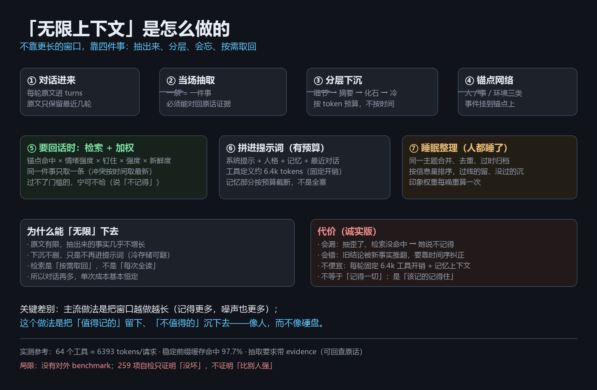

# 和主流方案的区别

一句话：**主流产品在做「会聊天的助手」，这个在做「会过日子的人」。**

前者解决"这次回答得好不好"，后者解决"三个月后她还记得我、还是同一个她吗"。



## 一张表

| | 通用助手（ChatGPT / DeepSeek / 豆包） | 角色陪伴（Replika / 星野 / 筑梦岛） | 记忆中间件（Mem0 / Zep / Letta） | Agent 框架（AutoGPT / OpenHands） | IM 机器人（NapCat + 各种 bot 插件） | **本项目** |
|---|---|---|---|---|---|---|
| 长期记忆 | 弱（靠会话记忆，跨会话就断） | 有，但多为"设定 + 摘要" | 强（向量/图谱），但只做记忆 | 无（任务是短生命周期） | 一般（多数只存最近 N 条） | **强：分层下沉 + 锚点网络 + 情绪加权** |
| 会不会忘 | 不主动忘，越堆越乱 | 基本不忘（越聊越糊） | 可配置，但无"人味"策略 | 不需要 | 靠截断 | **会忘，而且忘得有道理**（按价值/情绪/时间下沉） |
| 人格 | 助手人格，需每次靠提示词约束 | 人设强，但通常锁死不可改 | 无 | 无 | 可配置人设，通常静态 | **第一人称人格，她自己能改，底线不可改** |
| 主动性 | 纯被动（你不问它不答） | 有的会主动发消息（多为定时推送） | 无 | 被动执行任务 | 少数有定时任务 | **有自己的时间：走神 / 自主活动 / 自己去学东西** |
| 落到真实生活 | 网页/App 里聊天 | App 内 | 无落地 | 命令行/IDE | **在 QQ 群里**（这可能也是唯一落地的地方） | **QQ 群/私聊 + 表情包 + 计划表 + 手机工具** |
| 数据在哪 | 云端 | 云端 | 云端/自建 | 本地 | 本地 | **全在本机一个 SQLite 文件里** |
| 部署门槛 | 零 | 零 | 中（要接 SDK） | 中 | 中（要装协议端） | **高**（Node + QQ 协议端 + 一个模型 key） |
| 成本结构 | 订阅/按量 | 订阅 | 自付推理费 | 自付推理费 | 自付 | **自付，但可压到很低**（本地看图 + 缓存命中） |

## 三个别人基本做不到的地方

**① 记忆是"会淡忘"的，不是"无限堆"的**

主流两条路：要么不忘（向量库一直加，三个月后检索全是噪声），要么粗暴截断（最近 N 轮）。
这里做的是四条通路：

```
detailed（细节）→ compressed（摘要）→ fossil（化石）→ cold（冷存储）
            ↑ 按上下文预算下沉，不是按时间
            ↑ 检索时按「锚点命中 + 情绪强度 + 钉住 + 强度」加权
            ↑ 睡眠时做取舍：同一组里按信息量排序，过线的留、没过的归档
```

结果是：她能说出"你三周前为什么决定不换工作"，也能把"中午吃了什么"这种按预算自然沉下去。

**② 人格是她自己的文件，而且她知道能改**

```
data/persona.md      怎么想事、怎么说话        ← 她可以 persona_write
data/self.md         我是谁、我在乎什么        ← 她可以 self_write
data/think-prompt.md 静下来时想什么            ← 她可以 think_prompt_write
data/speech-rules.md 说话规矩                  ← 她可以 speech_rules_write
data/tuning.json     四个时间旋钮              ← 她可以 think_knobs_write
```

代码里只留一段**改不掉的底线**（不编造 / 不演客服 / 分清谁说的）。
多数产品的人格是产品经理写的、锁在后台的；这个项目的人格是她自己长出来的，而且她有权改。

**③ 有自己的时间**

```
每 1.5~3.5 分钟：走神（随机锚点 → 关联记忆 → 八问 → 决定做/B站/说话/算了）
每 6 分钟：自主活动（掷骰子决定要不要派阅读员去 B 站学东西）
到点：计划提醒插进走神（提醒≠必须做，可以改时间、可以做完）
```

不是"你问一句它答一句"的工具，而是"有自己的事要办"的个体。

## 缺点（不藏）

**① 部署门槛高。** 要装 QQ 协议端（NapCat / SnowLuma）、要 Node 24、要一个模型 key。不是双击就用的产品。

**② 单机单用户。** 没有多租户、没有云端同步、没有团队协作。手机丢了/硬盘坏了，记忆就没了（除非自己备份那个 SQLite）。

**③ 记忆质量取决于抽取。** 抽歪了要靠睡眠整理和人工纠偏——它不是"永远准确"，是"越来越准"。

**④ 成本随对话量线性涨。** 实测每轮请求里工具定义就占 ~6400 tokens（64 个工具）；记忆上下文另算。
稳定前缀命中缓存后能省很多（实测固定前缀 97.7% 命中），但对话越密集花得越多。

**⑤ 没有 UI。** 只有日志、markdown 手记、SQLite。想看她在想什么得 `read_log` 或翻 `data/journal/`。

**⑥ 平台风险。** 第三方 QQ 协议端属于合规灰区，有封号风险；官方机器人 API 又读不到群聊历史。这是所有 QQ 机器人的共同困境。

**⑦ 还没有对外基准。** 我们有 23 个自检脚本 / 259 项断言（跑真实入口，不是只 import），但那是"没坏"的证明，不是"比 Mem0 强多少"的证明。要横向比较得另做 benchmark。

## 适合谁 / 不适合谁

**适合**：愿意折腾、在意"长期关系连续感"、想要数据完全在自己手里、能接受一台常开的小机器。

**不适合**：想要开箱即用的陪伴产品（去用星野/Replika）、想要企业级记忆中间件（去用 Zep/Mem0）、想要一个能干活的编码 Agent（去用 Claude Code / OpenHands）。

## 一句话总结

> 主流产品在优化「这一次回答」，这个项目在优化「三个月后她还是她」。

前者是产品，后者更接近养一个东西。想清楚要哪个，再决定要不要用。
